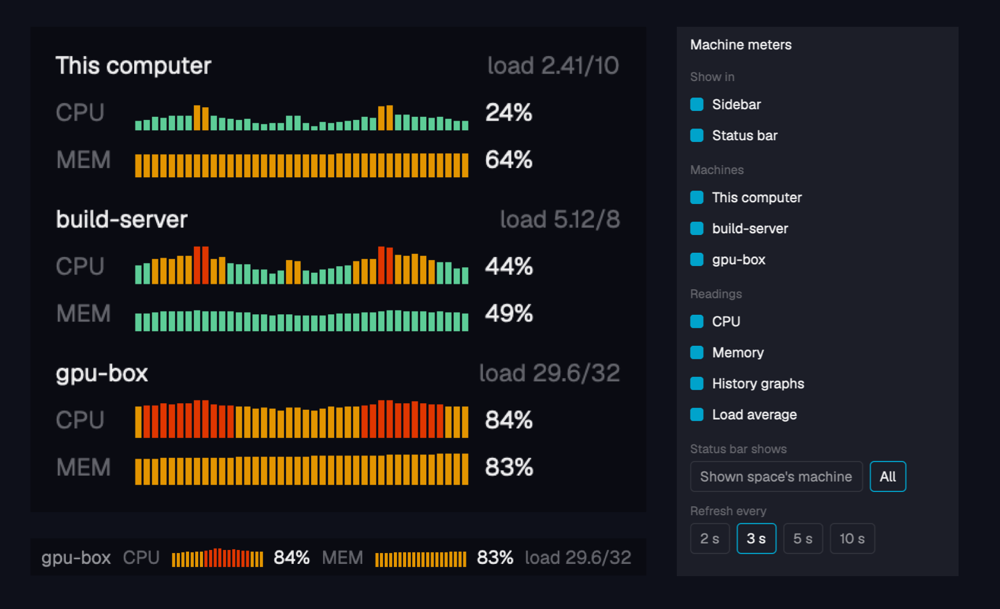

# Machine meters

A mod for the [Herdr](https://herdr.dev) desktop app: live CPU, memory and load for this computer and every machine you've added, in the sidebar, the status bar, or both.



*The sidebar card, the status bar line and the options, with sample machines.*

- **Every machine, local or over ssh.** Linux and macOS. Nothing to install on the machine: one small shell call per sample.
- **Sidebar and status bar.** A card per machine with CPU and memory history graphs in the sidebar; one line in the status bar that follows the machine of the space you are looking at. Turn either on or off from the mod's options.
- **Pick your machines.** Tick the ones to show; unticked machines are not sampled.
- **Pick your readings.** CPU, memory, their history graphs and load average, each on or off. Refresh every 2, 3, 5 or 10 seconds.
- **Green, yellow, red.** Below 60%, from 60%, from 85%.

This is an unofficial mod. It is not affiliated with Herdr.

## Install

Ask the agent in your Herdr window:

> Read `~/.config/herdr-app/AGENTS.md`, then add this mod: https://github.com/prakash-sr/herdr-machine-meters

Or by hand:

```sh
git clone https://github.com/prakash-sr/herdr-machine-meters
cp -R herdr-machine-meters/mods/machine-meters ~/.config/herdr-app/mods/
herdr-app do mod.open --name machine-meters
```

The last line opens the options. Under **Show in**, tick **Sidebar** and/or **Status bar**: the mod adds its block to the shown layout, above the sidebar footer and at the right end of the status bar.

Herdr's own layouts are read-only, so do this on a layout of your own. To get one from Herdr's:

```sh
herdr-app do layout.clone '{"name":"main","as":"mine"}'
```

To open the options from a key, add to `~/.config/herdr-app/keys.json`:

```json
{ "global": { "ctrl-shift-m": "mod.open:machine-meters" } }
```

### Placing the blocks yourself

In a layout with other ids than Herdr's `sidebar` and `status`, add the blocks where you want them:

```json
{ "id": "meters", "type": "block", "size": { "px": 82 }, "content": { "mod": "machine-meters" } }
```

```json
{ "id": "status-meters", "type": "block", "size": { "px": 430 }, "content": { "mod": "machine-meters", "props": { "variant": "bar" } } }
```

The sidebar block sets its own height to fit the machines and readings shown. The status bar line needs about 430 px a machine.

## Options

A click on either meter opens them in the middle of the window. They are kept in Herdr's shared state under `machine-meters`, so every copy of the mod follows them.

| Option | What it does | Default |
|---|---|---|
| Show in: Sidebar, Status bar | shows or hides that block; adds it if the layout has none | as the layout has them |
| Machines | which machines are shown and sampled | all |
| CPU, Memory, History graphs, Load average | which readings to show; without the graphs, the sidebar draws a bar for each | all on |
| Status bar shows | the shown space's machine, or all ticked machines | the shown space's machine |
| Refresh every | 2, 3, 5 or 10 seconds | 3 seconds |

## What it reads

- **Linux:** `/proc/stat` (CPU, as the change between two samples), `/proc/meminfo` (`MemAvailable` over `MemTotal`), `/proc/loadavg`, `nproc`.
- **macOS:** `sysctl` (cores, memory size, load), `vm_stat` (active, wired and compressed pages count as used), and the sum of `ps`'s per-process CPU share over the core count. That CPU figure is a short average, not an exact tick count.
- **Windows** machines are left out: the probe needs `sh`.

Load is the 1-minute load average over the core count: `2.0/2` means every core is busy.

## What it costs

One `sh -c` per shown machine per refresh, shared by the sidebar and the status bar copies. A hidden copy does not sample. Each new sample redraws the window, as any mod redraw does in Herdr, so choose a longer refresh on battery.

## Development

```sh
node test.mjs                                  # the layout logic, with the app's functions faked
herdr-app check mods/machine-meters            # loads the mod once
```

[RECIPE.md](RECIPE.md) is the brief an agent can rebuild the mod from.

## License

MIT
