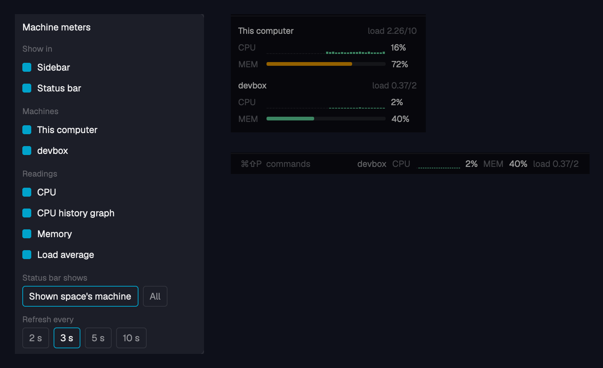

# Machine meters

Live CPU, memory and load for this computer and every machine added to Herdr, as a card per machine in the sidebar and as one line in the status bar. A click on either opens the options: where to show it, which machines, which readings and how often to refresh.

## What you see

**Sidebar card** (a block above the sidebar footer, `chrome` background, 1 px top border, 14 px side padding, 10 px above and below, text 11.5 px). One group per machine, 10 px apart, this computer first and the others by name:

- A title row: the machine's name in `foreground`, semibold, on the left (`This computer` for the local one); `load 0.45/2` in `dim` on the right (1-minute load average over the core count).
- A `CPU` row: the label in `dim`, 30 px wide; a history graph of the last 40 samples, 18 px high, each sample a 3 px bar with 1 px between, missing samples a 1 px bar in `border`; then the current percentage in `foreground`.
- A `MEM` row: the same label; a 160 px by 5 px rounded track in `border` filled to the used share; then the percentage.

**Status bar line** (a 360 px block at the right end of the 28 px status row, `chrome` background, 1 px top border, text 11.8 px, content right-aligned): the machine's name in `muted`, `CPU` in `dim`, a 20-sample graph 12 px high with 2 px bars, the percentage, `MEM` and its percentage, then `load 0.45/2` in `dim`. Groups are 18 px apart, items in a group 7 px.

**Colors of bars and fills:** `ansi2` (green) below 60%, `ansi3` (yellow) from 60%, `ansi1` (red) from 85%.

**Options popup** (260 px wide, `popover` background, text 12.5 px): the title `Machine meters`, then five sections with an 11 px `dim` heading each:

1. `Show in`: `Sidebar`, `Status bar`.
2. `Machines`: `This computer` and one row per machine.
3. `Readings`: `CPU`, `CPU history graph`, `Memory`, `Load average`.
4. `Status bar shows`: two chips, `Shown space's machine` and `All`.
5. `Refresh every`: four chips, `2 s`, `3 s`, `5 s`, `10 s`.

A row is a 12 px rounded box (filled `accent` when on, `surface` with an `input` border when off) and its label; the row gets the `hover` background under the pointer. A chip has a 1 px border, `accent` when chosen.

## How it behaves

- Every shown machine is sampled once per refresh interval (default 3 seconds). The sidebar and status bar copies share one sampler, so two copies cost one probe per machine.
- A copy whose block (or a node above it, such as a folded sidebar) is hidden does not sample or redraw.
- The status bar shows the machine of the shown space, and changes when the space does. With `All` it shows every ticked machine.
- A machine that is offline, or that has no `sh` (Windows), is left out. It comes back when a probe succeeds.
- Until the first sample arrives the card says `waiting for machines…`; a Linux machine shows a dash for CPU until its second sample.
- Without `CPU history graph`, the sidebar draws CPU as a bar like memory and the status bar drops the graph.
- A click anywhere on the card or the line opens the options at the pointer. Esc closes them.
- `Sidebar` and `Status bar` show or hide that block. If the shown layout has no such block, ticking adds one: the sidebar block before the node `sidebar-footer` in the column `sidebar`; the status bar block at the right end of the node `status` (a lone status block becomes a row that keeps it). A place the layout has no block for is marked `not in this layout`.
- Unticking a machine hides it and stops sampling it.
- `herdr-app do mod.open --name machine-meters` opens the options without a block on screen.

## Built from

- One mod, `mods/machine-meters/`: `main.js` and `mod.json` (`{ "place": "none", "overlay": { "width": 260, "height": 460 } }`).
- Props: none for the sidebar card; `{ "variant": "bar" }` for the status bar line; `{ "view": "settings" }` for the options popup. Opened as an overlay with no variant, the mod shows the options.
- From `herdr`: `exec`, `machines`, `spaces`, `theme`, `props`, `shared`, `setShared`, `layout`, `run`, `openOverlay`, `checking`. Commands: `layout.show`, `layout.hide`, `layout.set`.
- Options live in shared state under the key `machine-meters`: `{ interval, cpu, mem, load, graph, bar: "active" | "all", hidden: [machine names, "" for this computer] }`.
- The sampler is module-level state (`store`): per machine the CPU history, memory, load, cores and the previous `/proc/stat` totals; a revision counter that copies compare to know when to redraw. Each copy has a 1-second timer that samples when the interval is up.
- The probe is one `sh -c` per machine (`exec` with `on: name`, 5-second timeout):
  - Linux (`/proc/stat` readable): the first line of `/proc/stat`, `MemTotal` and `MemAvailable` from `/proc/meminfo`, `nproc`, the first field of `/proc/loadavg`. CPU is `1 - idle change / total change` between two samples, with iowait counted as idle.
  - macOS (`uname` is `Darwin`): `sysctl -n hw.ncpu hw.memsize vm.loadavg`, `vm_stat`, and `ps -A -o %cpu=` summed. Memory used is active + wired + compressed pages times the page size, over `hw.memsize`. CPU is the `ps` sum over the core count, capped at 100.
- `test.mjs` runs the layout functions (`block`, `find`, `setPlace`) against the shape of Herdr's main layout with the app's functions faked.

## Watch out

- Herdr's shipped layouts refuse structure changes, so adding a block only works on a personal layout (`layout.clone`). `run` returns nothing, so the mod cannot tell that a shipped layout refused; the place just stays `not in this layout`.
- Adding a block looks for the node ids `sidebar`, `sidebar-footer` and `status`. Layouts with other ids need the blocks placed by hand (see the README).
- The sidebar block has a fixed height, set for the machines shown when it was added (73 px each plus 12). With more machines the card scrolls; resize the block.
- The status bar block is 360 px, room for one machine. `All` with several machines needs a wider block.
- The macOS CPU figure comes from `ps` and is a short average, so it lags and differs from Activity Monitor's.
- Windows machines are not supported.
- Every new sample redraws the Herdr window, as any mod redraw does. Keep the timer at 1 second and redraw only when the sampler's revision changed.
- Module code is shared by all copies: keep the sampler there, but start timers in `init` and skip them while `checking()`.
- A second mod named `machine-meters` in the same home would share the options key.

## Done when

- `herdr-app check mods/machine-meters` passes, and `node test.mjs` prints `ok`.
- With a Linux machine added and a block in the sidebar, the card shows `This computer` and the machine, each with a load figure, a CPU graph that grows from the right and a memory bar.
- With the status bar block, the line shows the shown space's machine and follows a switch to a space on another machine.
- `herdr-app do mod.open --name machine-meters` opens the options; unticking `Status bar` hides the line and ticking it brings it back.
- Unticking a machine removes it from both places within one refresh.
- `herdr-app status` lists no errors.
